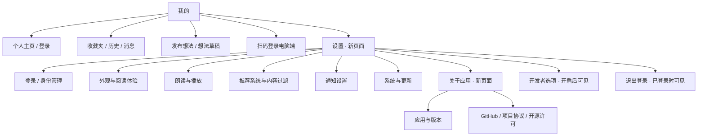

# “我的”与独立设置页设计更新方案

日期：2026-10-27  
状态：分支后续设计计划。`feat-account-settings-redesign-Wd3etO` 的 `37aae2ce` 已包含个人页与独立设置的基础实现；完成程度仍以验收为准，本文不宣称全部通过。线框为目标结构，不是页面截图。

本次修订：在既有多列、设置双栏与卡片／分割线方案上，补齐内容屏蔽、屏蔽记录、开发者选项的右栏设计，详见 §11。撤销这些页面“因复杂而沿用整页导航”的例外，将其列为完成条件。该计划此前仅存在主工作区的未跟踪文件中，本次以其为基础补入目标分支工作区。

## 1. 设计结论与范围

将“我的”改为以个人身份、收藏、历史、消息和创作为中心的轻量页面；将偏好配置、账户管理、更新与关于信息集中到新的“设置”页面。两个页面继续使用现有 HDS 导航、悬浮标题栏、语义颜色及圆角资源，统一视觉层级与滚动行为。

本次建议采用以下结构：

- **我的**：顶部设置入口 → 个人资料区 → 收藏夹 / 历史 / 消息快捷区 → 创作分组 → 扫码工具。
- **设置**：搜索 → 账户 → 使用偏好 → 应用 → 按条件出现的开发者选项 → 退出登录。
- **既有设置子页**：保留外观与阅读体验、朗读与播放、推荐系统与内容过滤、通知设置、系统与更新；内容屏蔽、屏蔽记录与开发者选项同时纳入设置内部导航，按 §11 重组复杂表单和列表。
- **关于应用**：新增承载页面，收拢应用与版本、GitHub、协议、许可与免责声明，避免设置首页继续成为长列表。
- **响应式布局**：“我的”按内容容器宽度在一列／两列之间切换；设置在窄窗逐级导航、宽窗分类与内容双栏之间切换。
- **列表样式**：支持卡片／分割线两种外观，与现有信息流样式选择保持一致；样式与布局分别计算，两个维度可自由组合。

本轮不增加个人统计接口、阅读推荐流或设置云同步，不拆分现有“外观与阅读体验”子页。复用既有样式偏好，扩展其展示名称和适用范围；个人页列数与设置双栏自动适配，不新增手动列数开关。保留已有偏好值、登录态、草稿与历史数据。

## 2. 重设计前的现状与不一致来源

以下为初稿基线问题；分支后续缺口以 §11.1 的源码核对为准。

| 当前实现 | 对体验的影响 | 本次调整 |
| --- | --- | --- |
| `AppShell.settingsPage()` 同时渲染个人区、创作、搜索、设置和关于诊断 | 页面名是“我的”，主体却是配置目录，重点不明确 | 拆为个人页与设置首页 |
| 已登录个人区右侧并列扫码和退出登录两个圆按钮 | 个人资料空间被压缩，退出操作与日常功能同等突出 | 扫码移到工具分组；退出移到设置末尾 |
| 三个独立快捷卡片之后继续堆叠大量双行导航项 | 视觉碎片较多，首屏缺少清晰的主次关系 | 快捷入口合为一组，减少重复说明 |
| “设置”与“关于与诊断”有更新、版本、项目主页等多处关联入口 | 用户难以判断在哪里更新、在哪里查看应用信息 | 系统与更新负责升级；关于应用负责产品信息与许可 |
| 设置搜索仍返回发布想法、草稿、收藏夹等个人功能 | “搜索设置”的范围与名称不一致 | 搜索只覆盖设置及其管理子项 |
| “我的”滚动容器仍使用 `padding.top = floatingTitleBarOffset()` | 视口本身被压到标题栏下方，与覆盖式标题栏规范不一致 | 改为滚动内容起始偏移，并保留滚动绑定 |
| “我的”底部让位固定为 `96` | 对底栏与手势区尺寸变化缺乏明确对应关系 | 使用底栏实际占位及安全区计算 |
| 个人页与设置分组未接入现有卡片／分割线选择 | 信息流切换风格后，管理页面仍固定为圆角表面 | 统一样式读取与分组渲染 |
| 个人页与设置目录沿纵向排列 | 宽窗口利用不足，长导航行难以阅读 | 个人页分组双列，设置分类与内容双栏 |

**统一的参照**是当前 `AppShell` 根标题栏、`AppPageChrome` 页面壳、首页滚动方式及现有设置分组资源。不同页面可以使用适合内容的布局，不要求把个人页做成信息流；需要一致的是导航、字体、颜色、间距、操作反馈和材质行为。

## 3. 信息架构与访问路径



“我的”是底栏一级页，无返回箭头；“设置”和“关于应用”是导航栈中的页面，有返回箭头。进入设置后不展示根底栏；返回“我的”恢复原滚动位置。窄窗按整页逐级导航；宽窗在设置容器内展示左侧目录与右侧内容，具体返回规则见 §6.3。现有消息页到通知设置、阅读场景到对应设置的快捷路径继续保留，返回时回到实际来源。

## 4. “我的”页面设计

### 4.1 目标线框

以下为窄窗、默认字号、卡片模式下的纵向结构。框线表示内容分组，不表示全部需要描边。底栏沿用用户当前配置，示意仅展示默认配置。分割线模式与宽窗结构分别见 §6.2、§6.3；既有默认样式仍为分割线，不因线框展示而改为卡片。

```text
┌──────────────────────────────────┐
│             系统状态栏           │
│ 我的                       [设置]│  HDS 悬浮标题栏
│                                  │
│ [头像]  用户昵称                 ›│  无大色块背景
│         查看个人主页             │
│                                  │
│ ┌──────────────────────────────┐ │
│ │   收藏夹     历史      消息   │ │  单个圆角浅底分组
│ └──────────────────────────────┘ │
│                                  │
│ 创作                             │
│ ┌──────────────────────────────┐ │
│ │ 发布想法                    ›│ │
│ │ 想法草稿                    ›│ │
│ └──────────────────────────────┘ │
│                                  │
│ 工具                             │
│ ┌──────────────────────────────┐ │
│ │ 扫码登录电脑端              ›│ │  仅已登录时显示
│ └──────────────────────────────┘ │
│                                  │
│       留白随可用空间自然伸展     │
│ [首页  关注  热榜  日报  我的]    │  现有悬浮底栏
└──────────────────────────────────┘
```

### 4.2 个人资料区

- 保留现有 56vp 圆形头像及真实头像失败后的首字占位；右侧昵称使用 `heading_font_size`，次行“查看个人主页”使用次级文字色。
- 头像与文字共同组成一个个人主页入口；尾部只保留轻量箭头，不与扫码、退出按钮竞争空间。
- 已登录但资料未加载完成时，保留头像占位与安全的显示名称，不显示 Cookie、账号标识串或伪造昵称。
- 未登录时使用相同尺寸结构，显示“登录知乎”和“登录后查看收藏与消息”；整块触发已有登录页。设置入口始终可用。
- 不新增关注数、粉丝数、收藏数量等统计，避免无数据时展示虚假的 `0`，也避免为个人首页新增请求。

### 4.3 快捷入口与功能分组

收藏夹、历史、消息合并为一个三等分的横向分组，保留各自独立点击与无障碍标签；图标在上、文字在下。每个入口默认最小高度 72vp，使用同一主题强调色，不再各占一张独立卡片。卡片模式使用统一圆角底，分割线模式使用页面底色与组间细线；两种模式保留相同入口顺序。将现有“通知”快捷入口的展示名称改为“消息”，与目的页标题对齐，目标仍是现有 `NOTIFICATION`。

创作组只保留“发布想法”“想法草稿”两行，使用现有 Symbol 与导航行组件。简单入口去掉“创建一条新的想法”这类重复描述，复杂设置中的说明仍保留。工具组使用“扫码登录电脑端”，让用途可读；继续调用现有扫码与确认流程。

未登录时仍展示三个快捷入口及创作组。收藏和消息按现有鉴权流程引导登录；历史与本地草稿保留本地可用能力，不因页面重设计统一加登录门槛。发布行为沿用现有鉴权检查，扫码入口沿用当前仅已登录可见的规则。

### 4.4 设置入口和更新提示

右上角使用仓库已用过的 `sys.symbol.gearshape`，点击区域至少 44 × 44vp，无障碍名称为“打开设置”。如果 HDS 工具栏样式允许，优先使用系统工具栏动作形态，不额外绘制一颗大型彩色胶囊。

发现新版本时，设置入口可显示小圆点；无障碍标签补充“有新版本”。进入设置后，在“系统与更新”尾部显示明确的“有新版本”标记。移除个人页直接跳 GitHub 的下载行，使用户统一进入已有更新页查看版本、说明与下载源。自动检查失败时不显示错误圆点，不在“我的”弹窗打断用户。

## 5. 独立“设置”页面设计

### 5.1 页面结构

```text
┌──────────────────────────────────┐
│ ‹              设置              │
│ [ 搜索设置                     ] │
│                                  │
│ 账户                             │
│ ┌──────────────────────────────┐ │
│ │ 身份管理                    ›│ │  未登录时替换为“登录知乎”
│ └──────────────────────────────┘ │
│                                  │
│ 使用偏好                         │
│ ┌──────────────────────────────┐ │
│ │ 外观与阅读体验              ›│ │
│ │ 朗读与播放                  ›│ │
│ │ 推荐系统与内容过滤          ›│ │
│ │ 通知设置                    ›│ │
│ └──────────────────────────────┘ │
│                                  │
│ 应用                             │
│ ┌──────────────────────────────┐ │
│ │ 系统与更新       有新版本   ›│ │  按检查结果显示
│ │ 关于应用                    ›│ │
│ └──────────────────────────────┘ │
│                                  │
│ 开发者选项                    › │  开启后出现独立分组
│                                  │
│ [          退出登录            ] │  已登录时显示，中性背景
│             系统安全区           │
└──────────────────────────────────┘
```

线框为窄窗卡片模式下可滚动的完整结构，不要求全部内容在一屏显示。设置目录只提供分类导航，不在目录行内嵌入主题切换、语速滑块等具体控件；宽窗下这些控件由右侧选中的既有设置子页承载。

默认分类摘要建议为“主题、排版与信息流”“语音与播放控制”“推荐来源、质量与屏蔽”“提醒与推送偏好”。摘要保持短句；不承诺每个分类都实时聚合所有配置状态。已加载的版本或主题摘要可作为尾部文本，读取失败时隐藏，不用假默认值表示已保存状态。

### 5.2 设置搜索

- 搜索框位于设置目录首部并参与该目录滚动；进入页面不自动聚焦、不主动唤起键盘。宽窗下目录位于左栏。
- 有非空查询时，下方分类内容整体替换为结果列表；清空查询恢复分组及原浏览位置。
- 索引覆盖分类标题、关键词及已有管理子项，例如“字号”“光感”“语速”“屏蔽记录”“版本”“Cookie”。本轮允许关键词跳到所属设置页，不宣称已具备页内定位或高亮能力。
- 每条结果显示名称及路径，例如“屏蔽记录 / 推荐系统与内容过滤”，让用户理解位置。屏蔽规则与屏蔽记录仍能直接进入既有页面。
- 发布想法、草稿、收藏夹退出设置搜索，保留在“我的”对应位置。
- 身份管理与开发者选项的可见条件同时作用于列表和搜索；未开启开发者模式时搜索“Cookie”不得暴露隐藏入口。
- 没有结果时显示“没有匹配的设置项”和“试试‘主题’‘朗读’或‘屏蔽’”，提供“清空搜索”操作。
- 搜索结果进入子页前收起键盘；返回后恢复查询与结果位置。宽窗点击结果更新右栏，左栏保留查询；清空只恢复目录，不重置右栏正在编辑的内容。返回键先关闭键盘，再按导航栈返回，不额外插入不可见的页面。

### 5.3 关于应用与退出登录

“关于应用”页面顶部展示应用名和已安装版本，下方分组包含“应用与版本”“GitHub”“项目协议”“开源许可”，底部放现有免责声明。第一版继续复用已有版本和许可弹层，不改动许可内容、链接或版本读取来源。更新检查与下载仍只由“系统与更新”承载。

原“应用与版本”行连续点击 5 次开启开发者选项的逻辑迁移到关于页对应行，保留现有计数和持久化行为；版本弹层内原有交互也一并核对。开启后返回设置立即显示“开发者选项”，提示其新的位置。开发者选项复用 `TechnicalLabPage` 内容；从设置内进入时由设置宿主呈现，模式关闭时的返回按 §11.5 执行。

退出登录置于设置页最后，独立于普通导航组。采用中性背景、危险语义文字色，保留当前确认弹窗、忙碌禁用及错误处理。成功后设置页更新为未登录态，“我的”账号区域同步刷新；不因页面迁移改变既有数据清理范围。

## 6. 视觉与布局规范

以下既有 token 值来自仓库；行高、宽度上限及大字模式策略为本次新增设计目标，需实现后在设备上确认。

| 项目 | 规范 |
| --- | --- |
| 页面背景 | `page_background`：浅色 `#FFFFFF`，深色 `#000000` |
| 分组底色 | 卡片使用 `surface_background`：浅色 `#F5F6F8`，深色 `#191A1D`；分割线模式与页面同底 |
| 文字与分隔线 | 复用 `primary_text`、`secondary_text`、`divider_color`；不硬编码白底黑字 |
| 强调色 | 只读 `resolvedThemeColor`；头像占位及快捷入口可使用相应主题容器色 |
| 字体 | 昵称 20fp；导航主文字 16fp；说明与组标题 14fp；辅助信息 12fp |
| 横向边距 | 沿用 `page_padding = 12vp`，与当前页面一致 |
| 圆角 | 卡片分组沿用 `card_radius = 16vp`；分割线分组不绘制圆角表面；控件自身圆角保持原语义 |
| 间距 | 大组间距 24vp，行内间距 14vp / 10vp，文字内部间距 4vp |
| 行尺寸 | 单行最小 56vp，双行最小 72vp；按内容和系统字体放大自然增长 |
| 图标 | 普通行 24vp，快捷入口 20–24vp；优先复用已核实的官方 Symbol |
| 分割线 | 行间线与文字列对齐；组间线与组边界对齐；不重复画两条边界线，不给每行加独立阴影 |
| 滚动与材质 | 内容可穿过悬浮标题栏；材质仅复用导航壳，正文组块使用实色表面 |
| 点击反馈 | 复用现有状态反馈；图标、名称、尾部箭头属于同一行点击区域 |

“我的”保留自然留白，不用营销横幅、渐变背景、大号欢迎词填满页面。设置页靠组标题、表面或细线及留白区分层级，不靠不同颜色为每类设置编码。切换分割线模式后仍须保留组标题和层级间距。

按钮、开关和勾选控件遵循仓库主题规则：主操作用 `resolvedThemeColor` 与 `onThemeColor()`，开关和 Checkbox 指定 `selectedColor`；取消、退出等操作使用中性背景。不要通过修改全局 `AppNavigationRow` 默认参数，顺带改变所有现有页面的外观。

### 6.1 安全区与适配

- “我的”使用 `contentStartOffset(floatingTitleBarOffset())` 一类内容起始偏移实现首屏让位，不对整个滚动视口施加顶端 padding；实现时核对当前 SDK 和既有首页用法。
- 保留个人页 Scroller 与根 HDS 导航的绑定；设置目录和详情各拥有独立 Scroller，与各自标题栏绑定，不能与个人页或另一栏复用同一个实例。
- “我的”底部按实际底栏高度、`bottomRectHeight` 与内容间隔让位；设置与关于页没有根底栏，只处理页面自身底部及系统手势区，避免重复加两份安全区。
- 正常字号保持三等分快捷区；窄窗或大字模式放不下时切为纵向三行，不能仅缩小文字或截断功能名称。
- 宽窗口采用 §6.3 的分组多列与目录／详情双栏。详情表单仍保持单列，建议内容最大宽度 720vp；不把整套设置控件排成瀑布流。
- 以窗口宽度和字体缩放决定布局，不以设备名称判断。头像与昵称区允许增长；非关键长昵称最多两行后省略，并保留完整无障碍名称。
- 最低兼容仍为 API 23；优先复用现有 HDS 材质封装。若新增自定义系统材质，必须走能力门禁与 try/catch，低版本使用已有模糊兜底，不无条件构造 `uiMaterial`。

### 6.2 卡片／分割线样式与偏好范围

将“外观与阅读体验”中现有“信息流样式”展示名改为“列表样式”，说明为“应用于信息流、我的与设置列表”。保留 `feedCardStyle` 的存储键、枚举值与默认值，通过公共样式解析层供新页面读取；本轮不重命名持久化字段，不新增第二份样式偏好。

适用范围包括“我的”的快捷与功能分组、设置目录、搜索结果、关于页，以及本方案涉及的外观与阅读、主题色、朗读、内容过滤、通知、系统更新设置页中的普通列表分组。它不自动重绘正文、评论、播放器、图表、预览块、系统弹层或按钮本身；内容屏蔽、屏蔽记录及开发者选项的普通分组、规则与记录列表必须按 §11 接入两种样式，不能以复杂页面为由排除。身份管理沿用分支已有嵌入路径，本次专项不重设计其表单；独立调试场景的专用渲染控件不在普通列表样式范围。更新页的版本提示等有独立语义的内容块可保留表面，但不能给所有普通设置行继续套固定卡片。

| 元素 | 卡片模式 | 分割线模式 |
| --- | --- | --- |
| 功能／设置分组 | 16vp 圆角、语义表面色、组间留白 | 页面同底，无外框、阴影和卡片圆角；以组标题、细线及留白分组 |
| 分组内行 | 保留必要的细分隔线，末行不额外加线 | 行间细线；组尾边界不与下一组首线重叠 |
| 快捷区 | 三个入口共用一个圆角表面 | 同样三等分排列，以底部细线与后续内容区分 |
| 多列分组 | 卡片按行对齐，每列独立表面 | 各列内独立分组，列间留白，不跨列绘制行分隔线 |
| 当前设置分类 | 行内主题容器色与文字状态表示选中 | 同样保留清楚的选中状态，不以卡片背景作为唯一提示 |
| 搜索结果 | 一个结果列表分组，不逐项堆小卡片 | 同底结果列表，以细线分隔 |

样式切换即时作用于已挂载页面，通过现有 AppStorage 广播传播；不重建路由、重发业务请求或清空搜索。保留当前功能项锚点、输入与焦点状态；只有布局尺寸确实改变时才重新计算可见区域。读取失败沿用既有偏好解码默认值，不覆盖已保存设置。

**列数与样式分开管理**：“信息流列数”名称及 `feedColumnMode` 语义保持不变，只控制信息流。设置为三列／四列不应把个人功能拆成三列／四列，也不应让设置变成多张表单并排。个人页与设置的自动适配规则在此节说明对应的外观设置帮助文案中提示，无需新增“全局列数”。

### 6.3 多列与双栏响应式规则

以下断点是本方案的初始设计值，单位均为 vp，需通过设备回归确认。宽度 `W` 取**当前页面实际分配的容器宽度**，不是屏幕物理宽度；窗口缩放、分屏与折叠后重新计算。

| 页面 | 默认字号下的初始规则 | 大字与空间不足时 |
| --- | --- | --- |
| 我的 | `W < 720` 单列；`W >= 720` 可用两列；整体内容最大宽度 1120vp | 双列需每列至少 320vp，扣除左右 12vp 和列间 24vp；文字测量不满足则回落单列 |
| 设置容器 | `W < 900` 目录与详情整页切换；`W >= 900` 可用左右双栏 | 左栏至少 280vp、右栏至少 480vp，加左右边距与栏间 24vp；字体放大后重新检查可读宽度，放不下则回落逐级导航 |
| 关于／设置详情内容 | 按所属详情栏宽度排成单列，内容最大宽度 720vp | 允许行高增长、摘要换行，复杂控件按容器重排，不缩小字体 |

断点和最小宽度必须同时满足。大字体时应提高最小宽度要求或根据实际文本和控件测量回退，不能仅检查固定的 320／480vp。各页共用一个布局判定入口；不得分别在标题栏、正文和底栏内维护不同断点。

**我的宽窗线框**：资料区与三入口快捷区跨两列，创作和工具以完整分组为单位并排；后续功能按行优先顺序填充，不将一个分组拆散到两列。不使用瀑布流，避免视觉位置与读屏顺序不一致。

```text
┌────────────────────────────────────────────────────────┐
│ 我的                                            [设置] │
│ [头像] 用户昵称 · 查看个人主页                         ›│
│                                                        │
│         收藏夹           历史           消息           │
│                                                        │
│ 创作                        工具                       │
│ ┌──────────────────────┐    ┌──────────────────────┐  │
│ │ 发布想法            ›│    │ 扫码登录电脑端      ›│  │
│ │ 想法草稿            ›│    └──────────────────────┘  │
│ └──────────────────────┘                              │
│                 现有悬浮底栏                           │
└────────────────────────────────────────────────────────┘
```

未登录隐藏工具组时，创作组占满内容宽度，不保留空白卡片。两列顶部对齐，短组不为追平高度而拉大行高。分割线模式使用同一布局，去掉图中卡片表面并保留各列内部细线。

**设置宽窗线框**：左栏保留完整目录、搜索和账户操作，右栏承载被选中的设置子页。搜索、退出按钮不复制到右栏。

```text
┌────────────────────────────────────────────────────────┐
│ ‹ 设置                  │ 外观与阅读体验               │
│ [ 搜索设置            ] │                              │
│ 账户                    │ 主题                         │
│   身份管理              │   主题模式      跟随系统     │
│ 使用偏好                │   列表样式      分割线       │
│   外观与阅读体验  [选中] │                              │
│   朗读与播放            │ 阅读                         │
│   推荐系统与内容过滤    │   排版与字号……              │
│   通知设置              │                              │
│ 应用                    │                              │
│   系统与更新            │                              │
│   关于应用              │                              │
│ [退出登录]              │                              │
└────────────────────────────────────────────────────────┘
```

设置双栏是一套设置内部导航结构，不能简单将整个根 Tabs 留在左栏、设置首页挤到右栏。优先复用 HDS 导航的分栏能力，实施前验证页面嵌套、标题栏与返回事件；设置作为一个普通目的地接入根栈，内部目录和详情维护单一逻辑路径。未来接入全局平板双栏时需共享容器宽度与导航宿主，同一区域只允许一层目录／详情分栏，不能叠成三栏、四栏。

导航与状态规则如下：

1. 首次从“我的”打开宽窗设置时，右栏显示“选择左侧设置项”的中性占位，不自动发起检查更新、播放或其他业务动作；当前设置实例已有选择时恢复该选择。
2. 左侧切换同级分类时替换右侧分类根页，不不断堆叠同级历史；点击已选项只聚焦原内容。继续打开主题色、许可等下级内容时，保留该分类内的返回路径。
3. 返回键优先关闭键盘／弹层，再返回右栏下级页面；处于分类根页时退出设置回实际来源。左侧标题栏返回按钮明确表示退出设置；右栏仅在有下级路径时显示返回按钮。
4. 从窄窗变宽窗时，把当前设置目的地显示在右栏并选中对应目录；从宽窗变窄窗时显示当前右栏内容，返回一级可见设置目录。若尚未选择分类，收窄后直接显示目录。切换尺寸不制造新的历史记录。
5. 左右栏分别保存滚动位置；尺寸／样式变化按稳定条目 ID 恢复可见项及其局部偏移，不只保存可能失效的像素滚动量。设置值、搜索查询、下载任务与播放控制器不因重排而重建。
6. 根标题栏和各栏标题栏职责分开，不叠加两层“设置”标题；目录与详情分别处理首屏让位、滚动材质及安全区。输入框唤起键盘后，焦点所在栏的控件仍可见。
7. 消息页等场景直接打开某个设置子页时保留原独立页面与返回路径，不为了宽窗布局强行插入设置目录；只有从设置容器进入的子页使用其内部双栏导航。

双栏、单栏与卡片、分割线必须四种组合都成立。分割线模式不会关闭多列，卡片模式也不会强制增加列数。

## 7. 功能迁移清单

| 当前入口或行为 | 目标位置 | 迁移要求 |
| --- | --- | --- |
| 头像 / 昵称 / 登录知乎 | 我的 · 资料区 | 保留个人主页和已有登录流程 |
| 收藏夹 / 历史 / 通知 | 我的 · 快捷区 | “通知”展示名改为“消息”；复用原目的页 |
| 发布想法 / 想法草稿 | 我的 · 创作 | 保留编辑器、草稿与鉴权行为 |
| 扫描电脑端登录二维码 | 我的 · 工具 | 改为有文字的行，保留确认流程 |
| 退出登录 | 设置 · 末尾 | 确认和忙碌状态不丢失 |
| 搜索设置 | 设置 · 首部 | 调整索引边界，保留设置子项关键词 |
| 身份管理 | 设置 · 账户 | 仅已登录显示；切换后两页同步 |
| 外观与阅读体验 | 设置 · 使用偏好 | 复用原页面及主题色子页 |
| 朗读与播放 | 设置 · 使用偏好 | 复用当前控制器，不新建播放器 |
| 推荐系统与内容过滤 | 设置 · 使用偏好 | 规则、记录子页均走设置内部路径，宽窗在右栏显示 |
| 内容屏蔽／屏蔽记录 | 设置 → 推荐系统与内容过滤 | 完成 §11 的标题壳、列表、表单、弹层与状态适配 |
| 通知设置 | 设置 · 使用偏好 | 保留消息页原有快捷入口 |
| 系统与更新 | 设置 · 应用 | 保留日志、下载源、校验及反馈能力 |
| 新版本下载提醒 | 我的设置标记 → 设置更新行 | 点击后统一进入系统与更新 |
| 应用与版本 / GitHub / 项目协议 / 开源许可 | 设置 → 关于应用 | 保留原有弹层和外部链接行为 |
| 免责声明 | 关于应用 · 页尾 | 文案完整保留 |
| 开发者选项 | 设置 · 独立条件分组 | 主页面纳入右栏；关于页开启后可见，关闭回目录／占位；搜索同一门禁 |
| 信息流样式 | 外观与阅读体验 → 列表样式 | 展示名称与范围扩展，存储键和已选值保持不变 |
| 信息流列数 | 原设置位置 | 仍只控制信息流；个人页多列、设置双栏自动适配 |

## 8. 实现边界与代码组织

### 8.1 路由兼容是首要约束

当前 `AppDestinationName.SETTINGS = 'Settings'` 对应 `TopLevelTab.ACCOUNT`，且底栏持久化配置默认包含 `Settings`。该字符串已经承载“我的”的历史语义。

第一版保留 `SETTINGS` 及其顶层映射，用注释明确兼容用途；新增 `SETTINGS_HOME = 'SettingsHome'` 和 `ABOUT_APP = 'AboutApp'` 作为普通栈内页面。新设置首页不得加入 `topLevelTabForDestination` 映射，也不加入可配置底栏选项。旧启动目标 `Settings`、旧底栏配置及既有返回路径仍进入“我的”。

新增目的地需同时补齐 `AppDestination.ets` 中枚举、类型联合、基础设施判定、解码及编码分支；不能只在 `destinationBuilder` 增加页面。`AppNavigation.test.ets` 覆盖新页面编解码，以及旧 `Settings` 仍映射个人页、新 `SettingsHome` 不映射顶层页的行为。

设置内部目录与详情的切换交由设置导航宿主管理；同一设置子页既能由该宿主嵌入右栏，也能由既有根路由独立打开，两种路径复用同一内容组件及业务状态接口。不要在根栈与设置内部栈同时推入同一个用户动作。现有路由编解码仍负责目的地标识，窗口尺寸只决定呈现位置，不改变路由数据。

### 8.2 初版文件职责与分支后续调整

下表为初版组织建议；目标分支已由 `SettingsHomePage` 承担内部布局与导航，不要求为满足旧文件名再复制一个宿主。三个补齐页面的具体落点与状态拆分见 §11.7。

| 文件 | 建议变化 |
| --- | --- |
| `entry/src/main/ets/pages/AccountPage.ets`（新增） | 资料、快捷入口、创作和工具展示；接收导航与账户动作 |
| `entry/src/main/ets/pages/SettingsHomePage.ets`（新增） | 分类分组、搜索、退出入口与更新提示；可作为窄窗整页或宽窗左栏目录 |
| `entry/src/main/ets/pages/SettingsNavigationHost.ets`（建议新增） | 设置目录与详情的单栏／双栏宿主、内部路径与返回事件协调 |
| `entry/src/main/ets/pages/AboutAppPage.ets`（新增） | 版本、项目与许可入口，免责声明 |
| `entry/src/main/ets/pages/SettingsSearchIndex.ets`（建议新增） | 设置搜索项、关键词与可见性，供结果和空态共用 |
| `entry/src/main/ets/pages/AccountSettingsLayout.ets`（建议新增） | 按实际容器宽度与字体适配结果判定列数、栏宽与回退，输出明确的布局类型 |
| `entry/src/main/ets/pages/components/AdaptiveSettingsGroup.ets`（建议新增） | 分组的卡片／分割线表面与边界渲染，不承载业务持久化逻辑 |
| `entry/src/main/ets/pages/AppShell.ets` | 根导航、标题栏动作、账户协调、主题持久化、更新检查与页面装配 |
| `entry/src/main/ets/pages/AppPageChrome.ets` | 只在必要时提供可选行参数；默认值不影响旧页面 |
| `entry/src/main/ets/pages/AppearanceSettingsPage.ets` 及 §6.2 涉及的设置页 | 更新“列表样式”名称、说明与搜索关键词，普通列表分组接入统一样式，支持右栏容器宽度 |
| `data/src/main/ets/preferences/AppPreferencesStore.ets` | 核对旧样式解码、默认值与保存行为；保留 `feedCardStyle`、`feedColumnMode` 键，不为页面扩展另存一份 |
| `entry/src/main/ets/pages/TopLevelScrollRegistry.ets` | 保留个人页滚动登记契约，必要时仅整理命名 |
| `core/src/main/ets/navigation/AppDestination.ets` | 新增两个目的地，保留旧路由语义 |

迁移以展示和导航解耦为主。账户退出、版本检查、主题设置持久化仍保留现有唯一写入方；页面通过动作回调调用，不复制 service 或 store。弹层必须只有一个有效承载点，不能同时挂在隐藏的个人页和新设置页而导致弹出两次或离开后残留。

跨页的登录、身份、主题与列表样式变化遵循项目已有 AppStorage 广播机制，使用 `@StorageProp` / `@Watch`，不依赖 HdsTabs 树下的 Builder 参数或 `@Provide` / `@Consume` 更新已挂载页面。搜索查询、分类选择、详情路径及滚动锚点属于导航实例状态，由布局分支上层持有，避免单栏／双栏组件切换时销毁。退出或切换身份后重新计算搜索可见项；若右栏正在展示已失去访问条件的身份管理等页面，退出该内容并回到有效目录／占位，不保留失效账户信息。

### 8.3 自动化节点

尽量保留既有功能节点，例如 `open_my_collections`、`account_quick_history`、`account_quick_notifications`、`open_pin_publish`、`open_pin_drafts`、`account_scan_desktop_login`、`account_logout` 及设置分类行 ID；只改变所在页面。补充 `account_open_settings`、`settings_home_scroll`、`settings_open_about`、`settings_master_pane`、`settings_detail_pane` 等新节点。对改名或删除的节点，在同一变更中更新对应测试与调试文档，不能复用同一个 ID 表示两个同时存在的控件。布局模式可通过测试状态暴露，不能靠猜测屏幕坐标判断是否双栏。

## 9. 实施顺序与验收

### 9.1 实施顺序

1. 先完成设置导航宿主最小验证：确认 HDS 单栏／双栏切换、内外层返回与标题栏无冲突；补齐设置首页、关于页路由及兼容测试。
2. 移入设置分组、搜索及关于内容，核对迁移表每一项；接入更新状态和开发者模式，保留外部场景直达子页的路径。
3. 重组个人资料、快捷区和工具区；增加标题栏设置动作，完成个人页一列／两列及设置目录／详情适配。
4. 接入共用卡片／分割线分组，更新样式设置名称、说明与搜索关键词；覆盖 §6.2 明确纳入的设置子页，验证旧配置不重置。
5. 按 §11.7 补齐内容屏蔽、屏蔽记录与开发者选项，不保留设置内部入口的根路由回退。
6. 统一滚动让位、安全区、深浅色、大字模式与布局切换状态恢复；检查共享组件没有牵连范围外页面。
7. 按仓库流程完成编译、Hypium、Debug 构建及设备回归，记录不同布局与样式的截图。Release 验证放在实际发行流程中执行。

多列、双栏、两种列表样式及 §11 三个复杂页面的适配都是本次完成条件，不能只交付手机卡片页面后标为方案全部实现。若 HDS 最小验证暴露技术阻碍，应记录具体失败行为与替代实现，保留未完成验收项，不将静默回退单列视为双栏适配完成。

### 9.2 可验证验收标准

| 场景 | 通过标准 |
| --- | --- |
| 我的默认首屏 | 默认字号、约 360 × 800vp 参考窗口下能看到资料区、全部快捷入口及创作组；设置始终在标题栏可达 |
| 信息分离 | 个人页不再包含设置搜索、偏好长列表、许可及退出按钮 |
| 入口完整性 | 迁移表所有功能可达；收藏、历史已配置为底栏页时继续复用既有行为 |
| 返回路径 | 我的 → 设置 → 子页逐级返回正确；从消息页进入通知设置返回消息页；无重复设置栈 |
| 登录 / 退出 / 身份切换 | 两页状态同步，未登录设置仍可用；不新增账号信息泄露或数据清理行为 |
| 搜索 | 分类及子项关键词可命中；无结果、清空、返回恢复正确；隐藏开发者选项不被搜索绕过 |
| 更新 | 有新版才出现提示；两级提示状态一致；点击进入原更新页；失败不产生虚假提醒 |
| 开发者模式 | 关于页按原规则开启，返回设置立即可见，重启后保持原持久化语义 |
| 滚动材质 | 个人页及设置页内容能经过标题栏下层，首屏无遮挡；切换页面后材质跟随正确 Scroller |
| 主题 | 浅色、深色、至少一种非默认主题色均正确；没有默认系统蓝控件或亮色残留 |
| 布局 / 无障碍 | 窄窗、大字体、横屏、宽窗不重叠；末项可点击；读屏名称完整，纯图标动作可理解 |
| 个人页多列 | 默认字号 719vp 为单列、720vp 起在满足最小列宽时双列；资料与快捷区跨列，功能组不拆分；工具隐藏不留下空卡片 |
| 三个复杂页面 | 内容屏蔽、屏蔽记录与开发者选项目录／子入口／搜索均留在设置内部，满足 §11.8 专项验收 |
| 设置双栏 | 默认字号 899vp 为逐级导航、900vp 起在满足最小栏宽时分栏；左目录右详情，首次占位明确，同级切换不堆栈 |
| 容器宽度与大字体 | 大屏分屏后的窄容器不误启双栏；大字体空间不足自动回退，不压缩字号；键盘出现后焦点控件可见 |
| 运行中重排 | 反复跨越断点，分类、子页路径、搜索、输入与滚动锚点保持；返回不跳页，不重复启动播放或下载 |
| 样式组合 | 窄窗／宽窗 × 卡片／分割线四种组合可用；分割线模式没有普通分组的残留卡片底色，列间线不串列 |
| 样式即时更新 | 在右栏修改样式时左栏立即同步，返回个人页已生效；不重置搜索、选中项或未保存输入 |
| 偏好范围 | 旧卡片／分割线选择被保留；信息流选择三列／四列不影响个人页最大两列及设置目录／详情结构 |
| 兼容性 | API 23 最低兼容设备与 API 26 分别验证，无未门禁材质构造 |
| 持久化兼容 | 升级前配置含 `Settings`、启动页为 `Settings` 的用户仍进入我的；偏好值不重置 |

建议补充有行为价值的测试：新路由编解码与旧配置兼容、搜索关键词与权限可见性、断点及最小宽度回退、设置内部路径在单栏／双栏之间转换、旧样式值与未知值的解析。UI 验证覆盖未登录 / 已登录、有更新 / 无更新、开发者模式开 / 关和返回状态，不为静态颜色或行数编写镜像实现的测试。

布局截图至少记录 360vp、720vp、900vp、1138vp 代表宽度；在 719／720vp、899／900vp 附近往返调整窗口，检查临界抖动与状态丢失。浅色／深色分别核对两种列表样式，并在大字体下复测回退。若实测需要调整初始断点，同步修改本文、公共布局判定与测试预期，不能只改其中一处。

实现后的命令按顺序执行：

```powershell
pwsh -NoProfile -File scripts/verify-harmony.ps1 -SkipDependencyInstall -SkipBuild
pwsh -NoProfile -File scripts/verify-harmony.ps1 -SkipDependencyInstall
```

如进入发行验证，再执行仓库规定的 Release 命令与产物校验；不能以本设计文档作为任何构建或设备验收通过的证明。

## 10. 初稿依据与验证边界

本节保留初稿参考来源；分支当前实现与本轮核对见 §11.1，不能将以下初稿函数名当作该分支最新实现清单。

- [AppShell](../entry/src/main/ets/pages/AppShell.ets)：`settingsPage`、`accountOverview`、`accountQuickActions`、`settingsSearchResults`、`destinationBuilder` 及根页签构建。
- [AppPageChrome](../entry/src/main/ets/pages/AppPageChrome.ets)：覆盖式标题栏让位约定、导航行与通用页面状态。
- [TopLevelTabs](../entry/src/main/ets/pages/TopLevelTabs.ets) 与 [AppDestination](../core/src/main/ets/navigation/AppDestination.ets)：个人页路由与顶层页签映射。
- [AppearanceSettingsPage](../entry/src/main/ets/pages/AppearanceSettingsPage.ets)、[SystemUpdateSettingsPage](../entry/src/main/ets/pages/SystemUpdateSettingsPage.ets)：既有偏好分组及版本、日志、下载能力。
- [尺寸资源](../entry/src/main/resources/base/element/float.json)、[浅色资源](../entry/src/main/resources/base/element/color.json)、[深色资源](../entry/src/main/resources/dark/element/color.json)：现有设计 token。
- [AppPreferencesStore](../data/src/main/ets/preferences/AppPreferencesStore.ets)：现有样式、列数偏好与默认值；本方案保留其存储兼容性。
- 全局平板导航需与设置内部宿主协调，避免嵌套分栏。目标分支尚无初稿曾引用的 `tablet-two-pane-plan.md`，本次不将该外部工作区草稿作为本分支必需依赖。

本次仅更新设计文档，未修改应用代码，未运行编译、Hypium 或构建。初稿编写时通过 deveco-cli 查询到连接设备名为 `ZhihuPlus_API26`（`127.0.0.1:5555`），读取到的是评论页布局；这不构成“我的”页视觉回归或 API 23 兼容验证。目标分支已有部分布局与样式实现，本轮未复验其设备效果；三页补齐设计仍待实施。后续须补齐真实页面对比截图和 §9、§11.8 验收记录。

## 11. 分支补齐设计：内容屏蔽、屏蔽记录与开发者选项

### 11.1 分支核对与完成边界

核对基线：`feat-account-settings-redesign-Wd3etO`，提交 `37aae2cea50280c31ba9811798f894b462066a5d`。本节为该分支后续实施计划，尚未实现；§2 保留重设计前的问题背景，不能据此判断该分支全部尚未改动。

| 源码事实 | 缺口 | 本次设计要求 |
| --- | --- | --- |
| `SettingsHomePage` 已有单栏／双栏和普通设置内容宿主；`SettingsPaneId` 未包含三个目标页 | `paneForEntry()` 无匹配时搜索结果转根路由；过滤页两个回调、开发者目录行也直接 `navigate()` | 三类入口统一解析为设置内部目的地，宽窗内容留在右栏，窄窗逐级显示 |
| `paneParent()` 仅处理主题色 → 外观 | 屏蔽子页缺少父级与目录选中关系 | 规则、记录的父级均为内容过滤；开发者是分类根页 |
| 两个屏蔽页自带 `pageHeader()`、`statusBarHeight` 定位和 `padding.top: 94` | 嵌入会重复标题、重复安全区及顶部留白 | 抽离标题壳，内容只消费宿主提供的可用区域与滚动起始偏移 |
| `BlockingRulesPage.aboutToDisappear()` 清理控制器和全部表单；记录页也释放控制器 | 单／双栏条件树重建可能丢草稿、列表位置及请求状态 | 区分布局重排、逻辑离页与最终销毁；状态所有者位于布局分支之上 |
| `TechnicalLabPage` 有固定 `Blank(64)`、固定卡片、局部开发者开关状态 | 与右栏标题、全局模式和列表样式不一致 | 正文容器化、分组样式接入、全局可见性门禁与统一会话状态 |
| `AppShell.disableDeveloperMode()` 持久化后直接 `pathStack.pop()` | 嵌入时会误退出整个设置页 | 拆分模式变更动作与导航动作，按入口来源执行返回 |

**完成条件**：从设置目录、过滤页或设置搜索进入这三个页面，均不得再以“复杂页面”为由跳出设置宿主。三页必须覆盖窄窗／宽窗 × 卡片／分割线四种组合。保留根路由兼容外部直达调用，但它不是设置内部入口的实现方式。

### 11.2 导航、标题与布局契约

```text
设置目录
├─ 推荐系统与内容过滤                  FILTER
│  ├─ 内容屏蔽                        BLOCKING_RULES
│  │  └─ 新增规则／导入导出／清空确认  模态操作，不增加第三栏
│  └─ 屏蔽记录                        BLOCKED_HISTORY
│     └─ 清空确认                     模态操作
└─ 开发者选项（开启后可见）            DEVELOPER
   ├─ 账号与会话／网络／本地存储       页内分组
   └─ 独立调试场景                    显式打开，返回原开发者页
```

| 用户动作 | 宽窗 | 窄窗 |
| --- | --- | --- |
| 过滤页打开规则／记录 | 替换右栏正文；左侧过滤分类保持选中 | 当前正文进入子页，目录隐藏 |
| 搜索命中规则／记录 | 右栏进入目标并建立 `FILTER → 子页` 路径，保留搜索词 | 进入目标，返回先到过滤页，再回保留查询的目录 |
| 目录／搜索打开开发者 | 右栏显示开发者分类根页 | 进入开发者页，返回目录 |
| 规则／记录返回 | 回过滤页，恢复其滚动锚点 | 回过滤页，再返回目录 |
| 分类根页系统返回 | 退出设置回实际来源 | 回目录，再退出设置 |
| 左侧设置标题返回 | 经过弹层／未保存输入处理后退出设置 | 目录上的返回退出设置 |
| 改变窗口尺寸 | 同一内部路径改呈现位置，不触发根栈 push/pop | 同左；子页仍是子页，不跳回分类根 |

左侧分类选中根据当前页的祖先计算；规则和记录不会使“推荐系统与内容过滤”失去选中状态。搜索结果也标出当前目标，清空搜索只恢复目录，不重置右栏。再次点击所属分类根入口回到该根页；点击当前目标不重载、不新建历史。同级分类切换只替换当前分类路径。

沿用 `resolveSettingsLayout()`：实际设置容器宽度达到 900vp 且满足字体缩放后的最小栏宽才双栏。右栏内容最大 720vp，三页内部始终单列，不随 `feedColumnMode` 的三／四列配置拆分规则、记录或表单；避免出现目录／规则／编辑器三栏。大字体、低高度和键盘场景通过行高、按钮换行及正文滚动解决，不压缩字号。

标题由当前宿主绘制一次。嵌入时规则和记录页不画自己的 `pageHeader()`，开发者页移除占位 `Blank(64)`；标题动作通过回调或 Builder 槽交给宿主。独立路由由页面壳提供相同标题和动作。所有返回均经过统一事件处理，不能在正文内直接操作根 `pathStack`。

统一安全区契约：覆盖式标题由正文唯一主 `List/Scroll` 使用宿主给出的 `contentStartOffset`，容器不再叠加固定 94vp 或状态栏 padding；宿主已按正常布局占位的标题则传 0。底部只计算实际手势安全区和正文内动作占位，不沿用“我的”底栏高度。每页的主 Scroller 独立登记并绑定当前标题材质。

返回处理优先级为：键盘 → 操作菜单／模态表单 → 未保存输入离页处理 → 内部父页 → 设置目录或实际来源。弹层打开期间背景目录不可操作；已提交任务的生命周期按 §11.6 处理，不由一次返回重复提交。

### 11.3 内容屏蔽页

```text
左：设置目录                右：‹ 内容屏蔽                 [更多]
推荐系统与内容过滤 [选中]        屏蔽开关
                                关键词屏蔽                 [开]
                                用户屏蔽                   [开]
                                话题屏蔽                   [开]
                                命中话题数量达到        [−] 1 [+]

                                [关键词] [用户] [话题]
                                当前 12 条              [新增规则]
                                规则内容／显示名            删除
                                匹配选项／ID
                                ……（同一主列表纵向滚动）
```

窄窗使用同一正文顺序与操作，隐藏左目录；不保留屏幕右下角悬浮加号，改为分类计数行的“新增规则”按钮，避免遮挡最后一条和键盘。紧凑宽度或大字体下按钮移至计数下一行。主列表包含开关组、分类控件、计数及规则行；开关组随正文滚动，避免矮窗下固定头占满规则列表。

| 区域 | 设计与行为 |
| --- | --- |
| 开关组 | 保留关键词／用户／话题三个开关；话题启用才展示阈值，仍限制 1–100。开关关闭不删除规则；保存忙碌时禁用冲突操作，失败显示真实状态 |
| 分类 | 三个文本选项；选中主题色，文字使用 `onThemeColor`。宽度不足改可横向滚动标签，不截断标签；切换保留各分类滚动锚点 |
| 规则行 | 关键词显示全文及大小写／正则标记；用户、话题显示名称及 ID；`questionAuthorOnly` 用户继续显示“仅提问者”语义。长串允许换行；删除按钮大字体时移至下一行，不挤压正文 |
| 新增 | 根据当前分类打开表单。关键词含输入、区分大小写、安全正则；用户／话题含 ID 与显示名。复用既有长度与正则校验，不新增联网用户查找 |
| 提交 | 校验错误贴近字段或表单状态区；业务错误保留非敏感输入。仅保存成功清空并关闭表单，列表更新后标明成功；不沿用当前关键词点击即清空导致失败丢稿的行为 |
| 更多 | “导入或导出屏蔽规则”“清空当前分类”两项。清空确认显示打开时的分类名称和数量，确认操作绑定该分类；不能因后台分类变化清错类别 |
| 导入导出 | 保留 JSON 文本输入、导入结果、导出预览与显式复制；沿用 `BlocklistBackup` 格式、条目校验和导入语义。导出在同一模态内切换预览视图，不再叠加第二个 sheet；失败保留输入并允许重试 |

宽窗表单以右栏内的居中模态展示，宽度不超过右栏减两侧各 16vp，目标上限 560vp；窄窗转底部或近全屏表单。模态正文可滚动，操作区随键盘抬升。不得只按全屏宽度判断 POPUP，必须测量当前承载栏。API 23 若不能将原生 sheet 定位至右栏，使用右栏内受限覆盖容器；焦点限制在模态内，整个设置背景禁止交互，不以重新打开完整页面规避适配。

载入、空分类、读取失败及有旧数据的刷新失败分开呈现；失败提供重新读取，旧列表仍可阅读，禁止将失败当作零条。保留 `BlockingRulesController` 的 busy、generation 保护；业务存储和匹配逻辑不复制到页面。

### 11.4 屏蔽记录页

```text
左：设置目录                右：‹ 屏蔽记录                 [更多]
推荐系统与内容过滤 [选中]        仅保存在本机，记录屏蔽操作摘要
                                删除记录不会解除屏蔽规则
                                最近记录
                                屏蔽关键词：示例关键词
                                相关内容标题（最多两行）
                                时间                       删除记录
                                ───────────────────────────────
                                屏蔽用户：示例作者
                                ……
```

该页呈现已有 `BlockedFeedRecord` 字段：规则类别／名称、内容标题和时间；不把它设计成“所有被过滤内容”的完整审计日志，不推断服务端统计。保留当前最近最多 500 条查询边界，不增加伪分页或后台拉取。

- 说明、状态和记录置于同一个主列表，避免大字体时说明区把记录挤出视口。记录按现有查询顺序展示，以记录 ID 作为稳定锚点；删除当前首项后锚定最近仍存在的下一项。
- 单条操作文案明确为“删除记录”；继续只调用记录 store，不删除规则、不解除屏蔽。没有内容跳转行为的行不加箭头，不新增“恢复内容”或“取消屏蔽”按钮。
- 更多菜单保留“清空全部屏蔽记录”；确认文案补全“仅清空记录，屏蔽规则继续生效；此操作无法撤销”。确认和取消使用清晰的危险／中性色，空列表或 busy 时禁用清空。
- 首次载入显示进度；零条显示“暂无屏蔽记录”；读取错误提供“重新读取”。有旧记录时刷新／删除失败以状态区提示，保留原列表，不清空后伪装成功。
- 卡片模式每条记录为独立表面、间距 10vp；分割线模式去掉卡片底色与圆角、间距归零，使用条目间细线。长名称换行；大字体时删除动作移到条目尾部独立一行。窄窗与右栏采用相同规则。

### 11.5 开发者选项页

```text
左：设置目录                右：开发者选项
开发者选项 [选中]               开发者模式                  [开]
                                关闭后隐藏入口并回到设置目录

                                账号与会话
                                当前登录状态          [验证登录]
                                手动设置 Cookie
                                [密码输入框                    ]
                                [确认设置并验证]
                                [退出并清理本地会话]

                                网络诊断
                                HTTP 探针状态
                                [运行 HTTP 探针]      [取消]
                                调试页面
                                原生长正文／图片与 GIF／……    ›
                                本地存储诊断
                                测试会话说明及两个既有操作
```

五个分组按上图纵向排列，不为宽窗额外拆成两列。标题、行、分组间距复用 §6；全页唯一 Scroll，输入框与结果随正文滚动，键盘开启时滚动至焦点及提交按钮。Cookie 使用密码输入和现有长度上限；不新增明文预览、自动读取剪贴板或日志输出。

| 分组 | 设计与状态约束 |
| --- | --- |
| 开发者模式 | 从全局 `developerModeEnabled` 读取并监听，目录、搜索、正文同一门禁。关闭立即隐藏目录及搜索结果、关闭当前弹层；宽窗右栏转占位，窄窗回目录。独立入口只返回其实际来源，不再无条件弹出 SettingsHome |
| 账号与会话 | 保留验证登录、手动 Cookie、退出清理。验证／提交显示忙碌文案，同一会话操作串行；退出使用中性背景与危险文字，并在执行前说明沿用的本地会话清理范围，不暗示删除收藏、规则或历史 |
| 网络诊断 | 默认“尚未运行”；显式点击运行，运行时禁用重复启动、启用取消，终态反向切换。结果只显示状态码／长度等现有摘要，取消后旧 Promise 不能覆盖“已取消” |
| 调试页面 | 保留原生长正文、图片与 GIF、连续阅读原型、数据库迁移、深链解析、二维码扫描、后台任务约束、领域模型夹具门禁八个入口，不自动运行。它们是独立调试场景，点击后可进入原根目的地；返回恢复开发者页所在右栏、锚点与非敏感结果。不得借此让“开发者选项”主页面本身退出右栏 |
| 本地存储诊断 | 保留“写入测试会话”“恢复并清理测试会话”及完整覆盖提示；会话状态未确定或已有真实登录态时禁用，未登录才可使用。增加操作中互斥，重复点击／resize 不重复写入；与登录验证、Cookie 提交、退出共享会话操作互斥 |

模式开关关闭不能撤销已提交的持久化写入。若会话变更正在执行，拒绝新操作并让现有 session owner 收束结果；移除页面观察者和敏感输入，结果仍经 `sessionStateTick`、`loginFeedReloadTick` 按原语义广播。模式关闭后浏览器返回、旧搜索结果或恢复路径均不得重显开发者表单；该页需要在显示和执行动作时检查可见性。

Cookie 未提交内容只存在当前页面会话的内存中：纯尺寸／样式重排可保留同一输入；离开开发者分类、进入独立调试场景、关闭模式、退出设置或提交时立即清空。不要存进 AppStorage、持久化偏好、路由参数或测试截图。这是普通表单“重排保留输入”规则的敏感字段边界。

### 11.6 样式、弹层与状态所有权

| 对象 | 卡片模式 | 分割线模式 |
| --- | --- | --- |
| 屏蔽开关／开发者功能组 | 语义表面＋16vp 圆角，组内规范行距 | 页面同底、无普通分组外框，用标题和行间细线分组 |
| 规则／记录条目 | 独立条目表面，内容内边距 14vp | 无条目卡片表面，保留内边距和组内细线 |
| 输入框／诊断结果／弹层 | 按交互控件与容器语义显示 | 保留输入边界和模态表面；不要因为分割线模式取消可编辑性提示 |

三页监听同一 `feedCardStyle`，不新增偏好。所有主按钮、选中分类、Switch 使用 `resolvedThemeColor`；按钮／图标前景按 `onThemeColor` 计算，替换屏蔽页当前硬编码白色。删除、清空、取消使用中性背景；破坏性文字使用语义危险色。触摸目标至少 44vp，危险操作的读屏名称包含目标对象。

状态按生命周期分工：

1. **布局重排**：保留内部路径、分类、普通表单、记录／规则锚点、HTTP 状态和任务标识。只重排视觉树，不 activate 新控制器、不重复读取和写入。一个设置实例只有一份业务状态所有者和一个可见弹层。
2. **离开当前分类**：非敏感规则草稿可在当前设置实例内保留，重新打开新增表单恢复；离开整个设置且存在未保存草稿时提供“继续编辑／放弃”确认。Cookie 按 §11.5 清空。退出模态的清空确认作废，不能返回时自动执行。
3. **请求运行中**：已提交规则／记录／会话写入由唯一 controller/service 完成，保持互斥，不能重放；返回已离开的页时只重读必要快照。HTTP 探针在逻辑离开开发者页时取消并递增请求代次，尺寸变化不取消。页面释放后陈旧回调不得更新已销毁视图。
4. **最终销毁**：关闭菜单和确认框、释放观察者和 Scroller 登记、清理全部内存草稿。存储层既有保存结果保留；不因销毁清空业务数据。

现有两个屏蔽 controller 的 `activate()` 会 reload，`deactivate()` 会改变 generation；实现时必须把状态所有者提升到布局条件树外，或提供等价的实例保活机制，不能只加 `embedded: true` 后仍依赖每次 `aboutToDisappear()` 清空。单栏和双栏也不能同时构建两份隐藏正文维持状态。

### 11.7 代码落点与实施顺序

| 文件 | 后续实施变化 |
| --- | --- |
| `SettingsHomePage.ets` | 增加三个 pane、父级映射、祖先选中、标题动作和内容槽；过滤回调与开发者目录／搜索统一使用内部选择；监听开发者可见性失效 |
| `SettingsSearchIndex.ets` | 保留原 entry ID 和可见性；补“话题／正则／导入导出”等规则页关键词；搜索激活使用相同内部路径解析，不另写根路由快捷分支 |
| `SettingsNavigationState.ets`（建议新增） | 可测试的父级、入口解析、返回与可见性失效逻辑；状态所有者承担路径与锚点，避免继续散落条件判断 |
| `BlockingRulesPage.ets`、`BlockedFeedHistoryPage.ets` | 内容／标题壳拆分、共用样式、唯一主列表、宿主限定弹层；保留 gateway 注入、操作节点和真实业务语义 |
| `BlockingRulesState.ets`、`BlockedFeedHistoryState.ets` | 支持宿主稳定持有和观察者生命周期；保留互斥与陈旧结果保护，必要时补明确的按目标分类清空契约 |
| `TechnicalLabPage.ets` | 嵌入正文、移除固定顶部占位、开发者门禁、分组样式、输入清理和操作状态；长异步逻辑可抽成 `TechnicalLabState.ets`，复用 app session owner |
| `AppShell.ets` | 三页 Builder 装配同时支持嵌入／独立；将 `disableDeveloperMode()` 的保存广播与返回解耦；根路由兼容路径不变 |
| `AccountSettingsLayout.ets`、`AppPageChrome.ets` | 复用现有布局判定和样式解析；仅补宿主需要的标题动作／起始偏移契约，不新建第三套断点 |

`@BuilderParam` 回调体只直接调用 Builder；条件写入被调用的 Builder。跨 HdsTabs 的模式、会话、主题广播仍使用 AppStorage＋`@StorageProp/@Watch`。任何 HDS／弹层能力先用 API 23 最小验证，不能通过引入无门禁 API 26 能力解决布局问题。

建议按下列可验收顺序推进：

1. 先补内部路由模型和返回测试，验证三个入口（分类／子入口／搜索）都留在设置实例。
2. 用屏蔽记录页打通唯一标题、主列表、单／双栏重排和弹层限定区域，确认基础壳后再迁规则页。
3. 完成规则开关、三分类、新增与导入导出，覆盖失败保留输入、清空目标绑定和一次提交。
4. 完成开发者分组、模式关闭的导航解耦、Cookie 生命周期和探针／会话操作互斥。
5. 接入两种样式、字体／短窗适配、独立路由兼容；最后按 §9 的顺序编译、Hypium、Debug 构建和设备回归。

### 11.8 专项验收与交付记录

以下各项为验收标准；截至 §11.9 的实施记录，功能实现已完成，设备与视觉验收仍在进行。

| 场景 | 通过标准 |
| --- | --- |
| 三页内部导航 | 900vp／1138vp 默认字号，从目录、过滤页和搜索进入后 `settings_master_pane` 仍可见，目标在 `settings_detail_pane`；根栈没有增加三个旧目的地 |
| 父级与搜索 | 规则／记录回过滤，开发者根页按宽窄规则返回；搜索词、过滤分类选中和原锚点恢复；无循环／重复栈 |
| 窄窗与重排 | 360vp、899↔900vp 连续切换，另测 1.5／2 倍字体触发回退；内部目标、草稿、记录位置保留，业务操作计数不增加 |
| 标题与键盘 | 每页一个标题及正确返回按钮，零重复 94／64vp 留白；横屏低高度、键盘显示后最后字段与提交按钮可达 |
| 规则功能 | 三类增删、三个开关、阈值上下界、正则／长度校验、仅提问者规则展示、导入导出复制均保留；校验／保存失败不丢普通输入 |
| 清空作用域 | 清空当前分类不改其他分类；清空记录不删规则；确认打开后切换／关闭／重排不会改变目标或自动提交 |
| 记录状态 | 0／1／500 条、长名称、无标题、加载失败、有旧数据时删除失败、删除可见锚点均可用，不显示虚假成功 |
| 开发者关闭 | 目录与搜索同步隐藏；宽窗占位、窄窗目录；不误弹出设置首页，不经旧恢复路径重开，Cookie 与弹层被清理 |
| 开发者异步 | 重复运行、取消后迟到结果、切类离页、resize、模式关闭均不会重复探针／会话写入或更新失效视图；登录后测试会话按钮禁用 |
| 调试往返 | 八个独立调试入口仍可达，返回恢复开发者页右栏与位置；Cookie 不恢复 |
| 样式与主题 | 三页四种布局／样式组合均通过；浅深色及非默认主题色无固定白色前景／残留卡片，分割线不跨左目录 |
| 兼容入口 | 旧 `BLOCKING_RULES`、`BLOCKED_FEED_HISTORY`、`TECHNICAL_LAB` 根目的地仍独立可用，返回真实来源；旧 `Settings` 底栏配置不变 |
| 设备兼容 | API 23 与 API 26 各测弹层、返回、输入与材质；记录实际设备/API、窗口 vp、字体倍率、样式和构建提交 |

测试以行为为主：扩充 `BlockingRulesState.test.ets`、`BlockedFeedHistoryState.test.ets`、`SettingsSearchIndex.test.ets`；新增导航状态及开发者异步代次／模式门禁测试，并在 `entry/src/test/List.test.ets` 注册。UI 自动化保留 `blocking_add_rule`、`blocking_*_input`、`blocking_clear_confirm`、`blocked_feed_history_list`、`developer_cookie_submit` 等 ID；嵌入标题返回统一使用 `settings_detail_back`，独立壳可继续保留原返回 ID。同屏不产生重复 ID。

交付截图至少包含三页各一组窄窗／宽窗对比、规则新增／备份模态、记录清空确认、开发者关闭后的落点，并补深色分割线与大字体短窗场景。截图使用虚构规则／记录和空 Cookie 字段；截图及诊断临时文件放 `.tmp/shots/`。记录未通过项，不再用“复杂页面仍整页打开”作为已完成说明。

本节源码依据：[设置宿主](../entry/src/main/ets/pages/SettingsHomePage.ets)、[搜索索引](../entry/src/main/ets/pages/SettingsSearchIndex.ets)、[内容屏蔽](../entry/src/main/ets/pages/BlockingRulesPage.ets)、[规则状态](../entry/src/main/ets/pages/BlockingRulesState.ets)、[屏蔽记录](../entry/src/main/ets/pages/BlockedFeedHistoryPage.ets)、[记录状态](../entry/src/main/ets/pages/BlockedFeedHistoryState.ets)、[开发者选项](../entry/src/main/ets/pages/TechnicalLabPage.ets)、[记录存储](../data/src/main/ets/data/BlockedFeedHistoryStore.ets)。本节初次核对时仅更新了计划，未改应用实现；实际实施结果见 §11.9。

### 11.9 实施记录（2026-10-27）

按 §11.7 的顺序完成第 1–4 步，并跑通第 5 步的编译、Hypium 与 Debug 构建；设备与视觉回归尚未执行。

| 项 | 实施结果 |
| --- | --- |
| 内部导航模型 | 新增 [SettingsNavigationState](../entry/src/main/ets/pages/SettingsNavigationState.ets)：pane 枚举、父级映射、祖先选中、路径、搜索入口解析、返回契约、开发者可见性门禁，均为纯函数；设置宿主改为委托该模块，不再各处散落条件判断。 |
| 宿主装配 | 三个 pane 接入目录行、过滤页两个回调与设置搜索；目录在窄窗进入详情时只隐藏不销毁（`Visibility.None`），跨断点重排保留目录滚动与搜索词；详情标题栏只画一次，子页登记后宿主渲染“更多”，切换页面先作废上一页的动作槽。 |
| 内容屏蔽 | 嵌入模式去掉自带标题与 94vp 让位；开关组、分类、计数与规则行合并为唯一主滚动；悬浮加号改为计数行“新增规则”（保留 `blocking_add_rule`）；分类选中前景改 `onThemeColor`；清空确认绑定打开时的分类与条数（`clearKind()`）；保存成功才清空并关闭表单，失败保留输入；嵌入弹层限定在承载栏内的覆盖容器。 |
| 屏蔽记录 | 说明、状态与记录并入同一主列表；卡片／分割线两套条目样式；删除文案改为“删除记录”；清空确认补充“仅清空记录、规则继续生效”；嵌入模式动作交给宿主标题栏。 |
| 开发者选项 | 移除 `Blank(64)` 占位；模式从全局 `developerModeEnabled` 读取并监听，关闭即隐藏入口、清空 Cookie 输入并取消探针；会话类操作共用一把互斥锁；HTTP 探针按请求代次丢弃迟到结果，逻辑离页取消、尺寸变化不取消；`disableDeveloperMode()` 拆成持久化广播与导航两段，嵌入入口只持久化。 |
| 测试 | 新增 `SettingsNavigationState.test.ets`（8 例）、搜索索引“话题／正则／导入”关键词用例、`BlockingRulesState` 按分类清空用例；Hypium 988/988 通过，Debug 构建通过。 |

设备抽查（模拟器 `ZhihuPlus_API26`，1320×2856 物理像素，窄窗 / 单栏）：设置目录 → 推荐系统与内容过滤 → 内容屏蔽，`settings_master_pane` 隐藏、`settings_detail_pane` 正常，宿主标题只出现一次（含 `settings_detail_back` 与 `settings_detail_actions`），规则页不再自带返回键与 94vp 留白；计数行“新增规则”打开的表单覆盖容器限定在右栏范围内（`blocking_rules_overlay` 顶边 = 右栏正文顶边），列表内容不被遮挡；屏蔽记录页说明／状态／记录同属 `blocked_feed_history_list`，删除按钮文案为“删除记录”；开发者选项页无 `Blank(64)` 占位，关闭开关后直接回到设置目录且目录中的开发者入口同步消失，设置本身未退出。宽窗双栏、卡片／分割线四种组合、大字体与 API 23 仍未验证。

补充修复（同日）：二级设置页此前同时存在 HDS 悬浮标题栏（“设置”）与宿主详情标题行，出现两条标题、两个返回键。现改为该目的地 `hideTitleBar(true)`，标题与返回全部由设置宿主绘制——目录行（“设置” + 关闭设置）与详情行（页标题 + 返回上级 + 更多）同高同风格，宿主按 `statusBarHeight` 自行让位，不再叠加 94vp 覆盖式留白；同时修正内容屏蔽页内容不足一屏时 Scroll 默认居中导致标题下大段空白的问题（`.align(Alignment.TopStart)`）。设备复验：目录、推荐系统与内容过滤、内容屏蔽三处均只有一行标题与一个返回键，逐级返回（规则 → 过滤 → 目录）与目录关闭设置正常。

仍待完成（§11.8 表格整体仍属待验证）：宽窗（900vp／1138vp）与平板横屏的双栏呈现；卡片／分割线两套样式的设备核对；规则分类切换与记录列表的滚动锚点保留；离开分类时的未保存草稿确认；大字体下删除按钮换行；深色主题与自定义主题色截图；API 23 弹层、返回、输入验证与截图归档。


