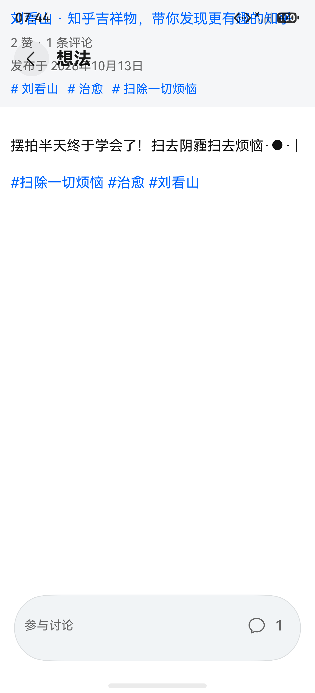
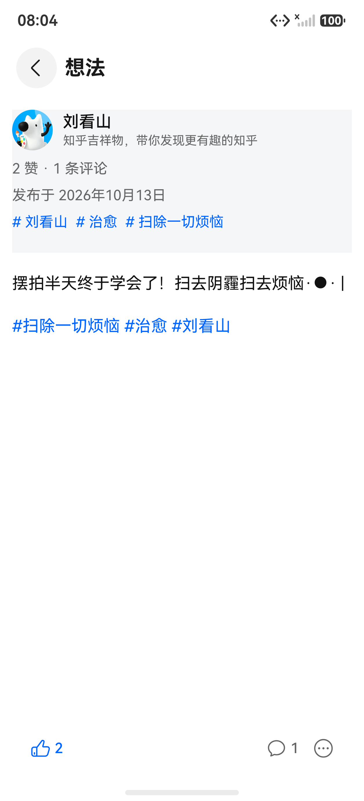
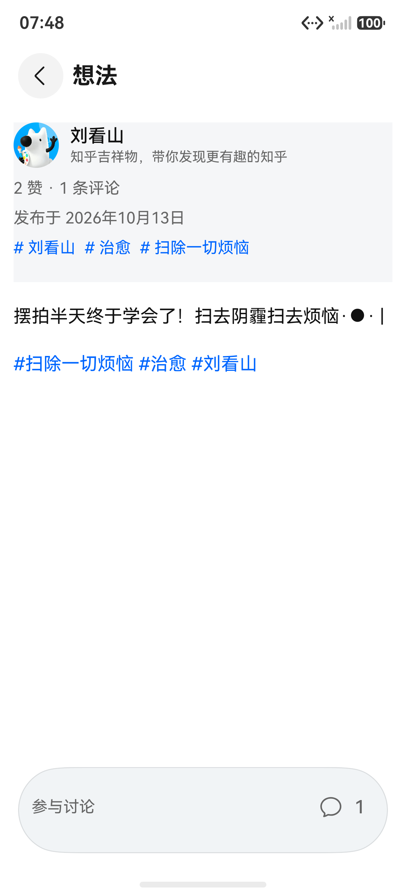
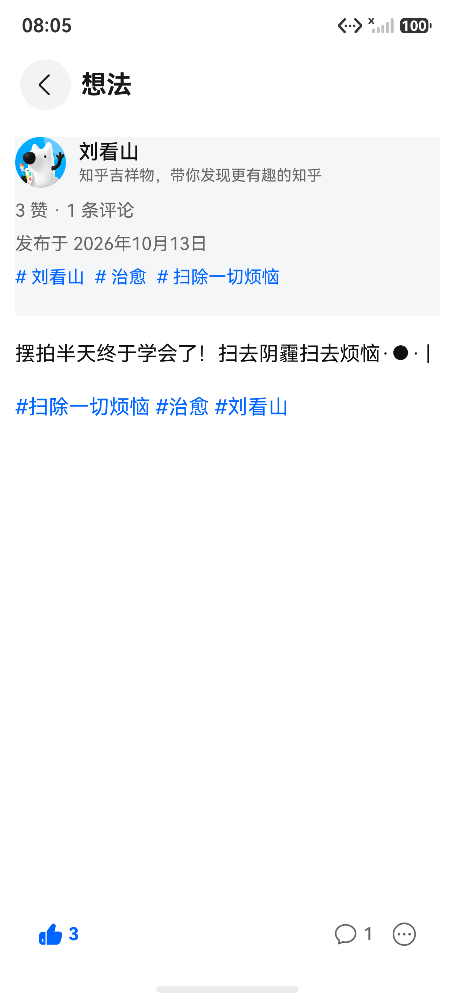

# Issue #78 想法详情排版验收

日期：2026-10-13。关联：[issue #78](https://github.com/zhuoyi233/zhihu-plus-plus-HMOS/issues/78)。

## 原因与修复

想法详情的作者、时间和话题原先固定在正文列表外。HDS 顶栏采用覆盖式布局，页面未为顶栏让位，信息头被挤到状态栏并与标题重叠；正文滚动也无法带走信息头。

参考上游 `PinScreen.kt` 的单一滚动区域，以及本地回答/文章详情的 `NativeContentDocument.documentHeader` 接入方式，将信息头移入正文列表。首屏使用共享 `FLOATING_TITLE_BAR_OFFSET` 让位，列表统一提供左右边距和底部操作栏避让。作者行沿用本地详情页头像、名称、简介样式，话题改为可换行布局。

底栏复用回答详情页的 `GlassCapsule`，左侧为点赞与实时计数，右侧为评论与更多操作；按钮尺寸、主题色与手势条避让和回答页一致，支持既有材质能力检测与模糊降级。点赞按上游请求 `pins/{id}/voters/up`，POST 点赞、DELETE 取消；从 `virtuals.is_liked` / `isLiked` 读取初始状态，应用服务端 `liked_count`，请求失败回滚，未登录提示登录，双击点赞保持幂等。

## 构建验证

- 首轮编译与 Hypium：`pwsh -NoProfile -File scripts/verify-harmony.ps1 -SkipBuild`，安装工作树缺失的 ohpm 依赖后，786/786 通过。
- 点赞与底栏重构后，`pwsh -NoProfile -File scripts/verify-harmony.ps1 -SkipDependencyInstall -SkipBuild`：Hypium 795/795 通过（新增 9 项接口、互动状态与详情快照回归测试）。
- 最终完整 Debug 构建：`pwsh -NoProfile -File scripts/verify-harmony.ps1 -SkipDependencyInstall`，构建与签名成功，Hypium 795/795 通过。
- HAP 元数据校验通过：API 26 编译，target 26、compatible 23，版本 0.5.8 / 1000508。
- 使用同一项目已有本机调试签名，`devecocli run --module entry --device 127.0.0.1:5555 --skip-build` 覆盖安装成功。

## 模拟器验收

目标：`ZhihuPlus_API23`，connectKey `127.0.0.1:5555`，保留已有登录态。

| 内容 | 实际验收结果 |
| --- | --- |
| 刘看山：[摆拍半天终于学会了](https://www.zhihu.com/pin/2093414907450496860) | 修复前复现作者挤到状态栏、时间与标题重叠；修复后头像、作者、简介、时间、话题均在顶栏下方，正文边距一致 |
| 同一条想法的双胶囊底栏 | 实际点赞后计数 2→3，实心图标与信息头同步更新；重新启动并进入后保留已点赞状态，点击一次取消，计数 3→2，恢复验收前状态；评论按钮加载出真实评论，更多按钮打开分享/屏蔽操作菜单 |
| 刘看山：[假期放纵后如何快速瘦 5 斤](https://www.zhihu.com/pin/2091597780602942935) | 多行文字、emoji、话题正常排版；点击底部评论按钮成功加载实际评论，返回详情正常 |
| 刘看山：[秋天的快乐，是小鸟给的](https://www.zhihu.com/pin/2091597494220055361) | 无话题的短正文正常显示，作者信息与正文之间间距正常 |
| 刘看山动态中的转发：[送小时候的自己一个礼物](https://www.zhihu.com/pin/2092010616877736908)（原作者：新知PLAYGROUND） | 长文本可连续滚动；信息头随正文滚出屏幕，正文尾部可滚至底部评论栏上方 |

布局树对照：同一条想法修复前时间位于屏幕 y=235–292，与 HDS 顶栏 y=137–332 重叠；修复后作者行 y=378–518、时间 y=645–702，正文列表视口仍从 y=137 开始，滚动可穿过顶栏。首轮长文本验收时正文末尾 y=2326、旧底栏起点 y=2368，无底部遮挡；重构后底栏起点 y=2494，按钮 y=2515–2641，沿用正文列表末尾 100vp 避让，操作区不再使用整行加高胶囊。

以上样本实际显示的是文本正文，本次不宣称已验证正文图片预览或视频播放。

## 前后截图

| 修复前 | 修复后 |
| --- | --- |
|  |  |

| 原底栏 | 重构后的底栏 | 点赞状态 |
| --- | --- | --- |
|  |  |  |
